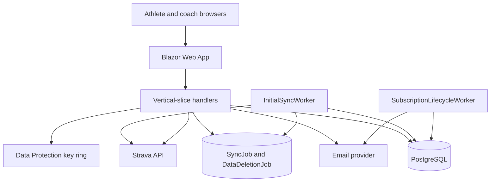
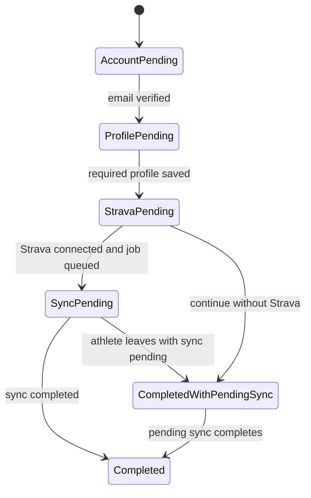
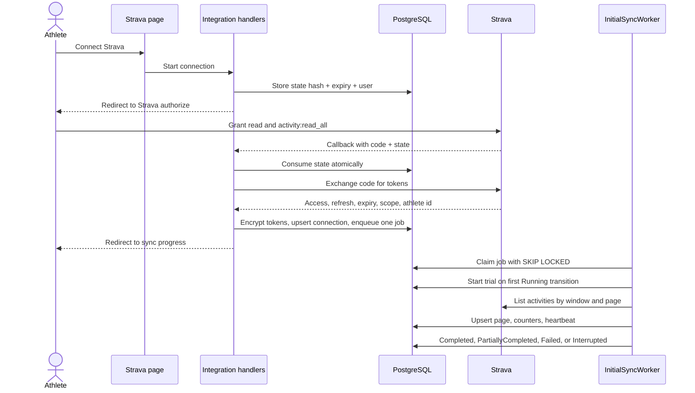

# Athlete Onboarding Design

**Spec**: `.specs/features/athlete-onboarding/spec.md`
**Status**: Approved
**Approved**: 2026-10-26 - user: "aprovado, pode criar as tasks"
**Date**: 2026-10-26
**Reference**: `fabiorhein/sprint-up-coach` at `010fe9c` (read for patterns and lessons only; no code is copied)
**Target**: .NET 10, single-project Blazor modular monolith, PostgreSQL 16

---

## Architecture Overview

SprintUp starts as an empty repository. The reference repository supplies architectural and product lessons, not a baseline: its implementation is scaffolding, and several of its decisions are superseded by the approved spec. The new solution is created from the .NET 10 template and follows the same shape that proved useful there: one deployable host, vertical slices per use case, module-owned domain and persistence, Minimal APIs under `/api/v1`, Blazor pages co-located with their feature, and one test stack.

One process serves the Blazor Web App, the Minimal API endpoints, the auth cookie, and the background workers. Modules own their data and expose contracts; no module reads another module's tables. A single `SprintUpDbContext` keeps transactions simple in the monolith, while `IEntityTypeConfiguration` classes stay inside each module.

**Alternatives considered.** A separate React/Next SPA would add a second deploy, a second toolchain, and a heavier build for a solo MVP. Razor Pages with HTMX would reduce the interactivity needed for sync progress and the coach dashboard. The user chose the Blazor full-stack monolith on 2026-10-26; the trade-offs are recorded in `AD-002`.



**Where the rules run.** Every rule that changes what a user sees runs in the domain or in a handler, never in a Blazor page: eligibility, profile bounds, age, invitation binding, OAuth state validation, token refresh, idempotent upsert, pagination, trial and retention transitions, visibility filtering, counts, totals, and coach authorization. Pages collect input and render read models. Integration tests call the same handlers the pages call, so the rules have tests behind them.

### Onboarding state



`CompletedWithPendingSync` never hides a failure: the athlete sees the job state and can retry. `Completed` requires either a `Completed` job or an explicit decision to continue without Strava.

### OAuth and initial sync



### Confirmed scope decisions

| Decision | Choice | Consequence |
| --- | --- | --- |
| Application architecture | Blazor full-stack modular monolith on .NET 10 | One deploy, one runtime, and the reference project's proven shape. |
| Database | PostgreSQL 16 with EF Core 10 and Npgsql | Real `jsonb`, partial indexes, and `SKIP LOCKED`; matches local Docker and Testcontainers. |
| Tenancy model | Coach-athlete only; no `Team` entity | Simpler assignments and permissions; team grouping deferred. |
| Strava app capacity | Approved for more than 10 athletes | No Single Player capacity blocker; rate limits remain the operational constraint. |
| Coach access | Minimal coach access is inside this feature: operator-created coach account, email/password sign-in, read-only dashboard, and invitation approval. Public coach sign-up and coach applications remain outside (Q-33). | REV-04, SYN-22, LIFE-07, and ONB-16 have a real user path and real tests. |
| Authentication | Custom `User` aggregate with `PasswordHasher<User>` and an HTTP-only cookie. ASP.NET Core Identity EF stores are not used. | Fewer tables, no parallel user model, and full control of the approved account states. |
| Invitation issuance | An operator creates coach accounts; the operator or an active coach issues athlete invitations bound to one coach. | The invitation path works in the MVP without building public coach registration or a coach marketplace. |
| Athlete during inactivity | The athlete can sign in read-only during the 30-day retention, can disconnect Strava and delete the account, and cannot start a sync or edit notes. | The trial keeps a commercial limit while the athlete can still act on their data. |
| Trial start | The 30-day trial starts when the first sync job transitions to `Running`, not when it is queued. | "The first sync starts" means the worker actually starts importing. |

---

## Reference Reuse Analysis

### Patterns to adopt

| Pattern | Reference location | How the new solution uses it |
| --- | --- | --- |
| Modular monolith with vertical slices | `.specs/codebase/ARCHITECTURE.md` | Each use case is a folder with command/query, handler, endpoint, page, and tests; modules own their domain. |
| Module folders `Domain/Features/Infrastructure` | `src/Modules/UserManagement/` | Same shape for `UserManagement`, `Coaching`, `Integrations`, `Training`, and `Subscriptions`. |
| Minimal APIs under `/api/v1` | `.specs/codebase/CONVENTIONS.md` | Mobile-ready endpoints, no controllers. Blazor pages call the same handlers. |
| RFC 7231 `ProblemDetails` and stable error codes | `.specs/codebase/CONVENTIONS.md` | One exception handler maps domain and validation errors; the UI localizes codes. |
| No AutoMapper and no generic repository | `.specs/codebase/CONVENTIONS.md` | Explicit mapping methods; handlers use `SprintUpDbContext` or a specific store. |
| `IActivityProvider` boundary | `.specs/codebase/INTEGRATIONS.md` | Provider-neutral ingestion; Strava JSON stays inside `StravaActivityProvider`. |
| Blazor Web App with Bootstrap 5 | `.specs/codebase/STACK.md` | Static SSR for auth and OAuth callbacks; InteractiveServer for forms and progress. |
| PostgreSQL plus Docker Compose | `docker-compose.yml` | PostgreSQL 16 for local development and Testcontainers in tests. |
| xUnit, FluentAssertions, Moq, bUnit | `.specs/codebase/TESTING.md` | Same baseline, plus Testcontainers and Playwright for the new integration and viewport needs. |
| Consent records and LGPD discipline | `.specs/project/PROJECT.md` | Append-only consent rows, data minimization, PII-free logs, deletion and retention. |
| PT-BR/EN resources | `.specs/project/PROJECT.md` | `.resx` resources for validation, pages, and emails. |

### Lessons not carried forward

| Reference decision | Why it is not adopted |
| --- | --- |
| Copying the scaffold as a baseline | The handler, endpoint, page submit, and test are stubs. Starting empty avoids inheriting dead code and stale configuration. |
| .NET 8, controllers, and SQL Server in `src/Program.cs` | The approved target is .NET 10 with Minimal APIs and PostgreSQL. |
| Weight, height, and gender required at registration | The approved spec makes them optional and consent-gated. |
| `UserStatus.EmailValidationPending`, `Suspended`, `Deactivated` | Replaced by `PendingVerification`, `Active`, `Inactive`, `Deleted`. |
| Google-first onboarding and Spanish | Email/password first; PT-BR and EN only in the MVP. |
| Aider/Gemini workflow in `README.md` | The project uses OpenCode and the specs in this repository. |

The reference repository has no production data and no reusable implementation. Nothing is imported into `sprintup`.

---

## Solution Layout

```text
SprintUp.sln
src/
  SprintUp/
    Program.cs
    Components/
      App.razor
      Routes.razor
      Layout/
    Modules/
      UserManagement/
        Domain/
        Features/
        Infrastructure/
      Coaching/
        Domain/
        Features/
        Infrastructure/
      Integrations/
        Domain/
        Features/
        Infrastructure/
      Training/
        Domain/
        Features/
        Infrastructure/
      Subscriptions/
        Domain/
        Features/
        Infrastructure/
    Shared/
      Domain/
      Infrastructure/
      Resources/
    wwwroot/
tests/
  SprintUp.UnitTests/
  SprintUp.IntegrationTests/
  SprintUp.UiTests/
  SprintUp.E2E/
  SprintUp.PerformanceTests/
```

Module rules:

- `Domain` has no dependency on UI, EF Core, or another module.
- `Features` holds one folder per use case with handler, contracts, endpoint, and page.
- `Infrastructure` holds EF configurations, provider adapters, and module registration.
- A module exposes a `Contracts` folder when another module needs a query; it never exposes its `DbContext` sets.
- `Shared` holds cross-cutting infrastructure only: `SprintUpDbContext`, auth, clock, localization, error handling, Data Protection, and email abstraction.

---

## Components

### UserManagement module

- **Purpose**: Own accounts, authentication, verification, consents, athlete profiles, invitations, and account status.
- **Location**: `src/SprintUp/Modules/UserManagement/`
- **Interfaces**:
  - `RegisterAthleteHandler.Handle(RegisterAthleteCommand command, CancellationToken ct): Task<RegisterAthleteResult>` - normalizes email, enforces uniqueness, hashes the password, records terms/privacy consent, assigns the AI coach, and issues a verification token.
  - `VerifyEmailHandler.Handle(string token, CancellationToken ct): Task<VerifyEmailResult>` - consumes a single-use token and advances onboarding to `ProfilePending`.
  - `ResendVerificationHandler.Handle(Guid userId, CancellationToken ct): Task` - invalidates previous unconsumed verification tokens before issuing a new one.
  - `LoginHandler.Handle(LoginCommand command, CancellationToken ct): Task<LoginResult>` - verifies password and account status, then issues the auth cookie.
  - `CompleteProfileHandler.Handle(CompleteProfileCommand command, CancellationToken ct): Task<OnboardingStateDto>` - validates required and optional fields and advances to `StravaPending`.
  - `SetPreferencesHandler.Handle(Guid userId, string language, UnitPreference units, CancellationToken ct): Task`.
  - `RecordConsentHandler.Handle(RecordConsentCommand command, CancellationToken ct): Task` - append-only consent rows with document version.
  - `AcceptInvitationHandler.Handle(AcceptInvitationCommand command, CancellationToken ct): Task<AcceptInvitationResult>` - binds the invitation to the authenticated email, or moves it to `PendingCoachApproval`.
  - `ApproveInvitationHandler.Handle(Guid coachUserId, Guid invitationId, bool approve, CancellationToken ct): Task` - coach decision for a mismatched email.
  - `CreateInvitationHandler.Handle(CreateInvitationCommand command, CancellationToken ct): Task<InvitationDto>` - admin or active coach; always bound to one coach; the target coach must be `Active`.
  - `CreateCoachHandler.Handle(CreateCoachCommand command, CancellationToken ct): Task<CoachDto>` - admin only; creates the coach login and an activation token.
  - `ActivateCoachHandler.Handle(string token, string password, CancellationToken ct): Task` - sets the coach password and activates the login.
  - `ContinueWithoutStravaHandler.Handle(Guid userId, CancellationToken ct): Task` - moves onboarding to `CompletedWithPendingSync`.
  - `GetOnboardingStateHandler.Handle(Guid userId, CancellationToken ct): Task<OnboardingStateDto>` - single source for resume and route guards.
- **Dependencies**: `SprintUpDbContext`, `IPasswordHasher<User>`, `IEmailService`, `ICoachAssignmentService`, `TimeProvider`, `IStringLocalizer<SharedResources>`, `ICurrentUser`.
- **Reuses**: the reference `RegisterUser` slice shape, the 18+ invariant, and the consent idea; the implementation is new.

**Login status rule.** `PendingVerification` cannot sign in. `Active` can sign in. `Inactive` cannot sign in; the purge is in progress and coach access is already revoked. `Deleted` does not exist as a login.

**Coach activation.** An operator creates a coach with name and email. The system creates a `User` with role `Coach` in `PendingVerification` and a `Coach` profile in `Active`, then emails a 24-hour activation link where the coach sets a password. An expired or used link offers a new activation email initiated by an operator.

### Coaching module

- **Purpose**: Own coach identities, coach-athlete assignments, the AI primary coach, and the coach read model.
- **Location**: `src/SprintUp/Modules/Coaching/`
- **Interfaces**:
  - `IAssignmentService.AssignAiCoachAsync(Guid athleteUserId, CancellationToken ct): Task` - idempotent; called at registration.
  - `IAssignmentService.AssignHumanCoachAsync(Guid athleteUserId, Guid coachId, CancellationToken ct): Task` - rejects a second active human coach.
  - `IAssignmentService.RevokeAllAsync(Guid athleteUserId, DateTimeOffset now, CancellationToken ct): Task` - deletion and retention end.
  - `ListAssignedAthletesHandler.Handle(Guid coachUserId, CancellationToken ct): Task<IReadOnlyList<AthleteSummaryDto>>`.
  - `GetAthleteOverviewHandler.Handle(Guid coachUserId, Guid athleteUserId, CancellationToken ct): Task<AthleteOverviewDto>` - status, counts, sync state, subscription state, recent activities, notes; no tokens or health data.
  - `CoachAccessPolicy.CanReadActivities(...)`, `CanReadHealthData(...)`, `CanApproveInvitation(...)` - evaluated in handlers, never in pages.
- **Dependencies**: `SprintUpDbContext`, `ITrainingQueries`, `ISubscriptionQueries`, `ISyncStatusQueries`, `ICurrentUser`, `TimeProvider`.
- **Reuses**: the reference project's future coach hierarchy intent, reduced to coach-athlete only.

**AI coach.** A seeded `Coach` row with `Kind = Ai` and no `UserId` is created by migration and marked `Active`. Every athlete receives an `AiPrimary` assignment in the same transaction as registration. A human assignment is always additional; `AiPrimary` stays primary.

**No team entity.** The spec language mentions a coach or team. The MVP models coach-athlete only; an invitation is bound to exactly one human coach. A `Team` entity is deferred and would attach to `CoachAssignment` later without changing the invitation contract.

### Integrations module

- **Purpose**: Own Strava OAuth, token lifecycle, provider-neutral ingestion contracts, and Strava mapping.
- **Location**: `src/SprintUp/Modules/Integrations/`
- **Interfaces**:
  - `IActivityProvider.GetAuthorizationUrl(string state): string`.
  - `IActivityProvider.ExchangeCodeAsync(string code, CancellationToken ct): Task<ProviderTokens>`.
  - `IActivityProvider.RefreshAsync(string refreshToken, CancellationToken ct): Task<ProviderTokens>`.
  - `IActivityProvider.ListActivitiesAsync(string accessToken, DateTimeOffset after, DateTimeOffset before, int page, int perPage, CancellationToken ct): Task<ProviderPage>` - `ProviderPage` includes activities and rate-limit metadata.
  - `IActivityProvider.RevokeAsync(string accessToken, CancellationToken ct): Task`.
  - `ConnectStravaHandler.Handle(Guid userId, CancellationToken ct): Task<AuthorizationRedirect>` - stores the state hash and returns the Strava URL.
  - `StravaCallbackHandler.Handle(string code, string state, CancellationToken ct): Task<CallbackResult>` - consumes state, exchanges the code, upserts the connection, and enqueues exactly one job.
  - `DisconnectStravaHandler.Handle(Guid userId, DisconnectChoice choice, CancellationToken ct): Task` - revokes at Strava, marks `Revoked`, interrupts any job, and schedules history deletion when chosen.
  - `StravaTokenService.GetValidAccessTokenAsync(Guid connectionId, CancellationToken ct): Task<string>` - refreshes once when the token expires within five minutes, persists the rotated refresh token, and marks `NeedsReauthorization` on failure.
  - `IStravaRateLimitGate.WaitAsync(StravaRateLimitSnapshot snapshot, CancellationToken ct): Task` - shared throttle for the application.
- **Dependencies**: typed `HttpClient`, `StravaOptions`, `IDataProtector`, `SprintUpDbContext`, `TimeProvider`, `ILogger`.
- **Reuses**: the reference project's provider abstraction intent; the adapter is new.

`ProviderActivity` is provider-neutral and contains only fields the spec stores. `StravaActivityProvider` is the only type that knows Strava JSON names such as `sport_type`, `manual`, `moving_time`, and `start_date_local`.

### Training module

- **Purpose**: Own activities, notes, hiding, sync jobs, pagination, idempotency, and history read models.
- **Location**: `src/SprintUp/Modules/Training/`
- **Interfaces**:
  - `StartInitialSyncHandler.Handle(Guid userId, SyncWindow window, CancellationToken ct): Task<SyncJobDto>` - returns the existing active job instead of creating a second one.
  - `InitialSyncWorker` - hosted service that polls and claims queued jobs.
  - `InitialSyncRunner.RunAsync(Guid jobId, CancellationToken ct): Task` - executes one job in a fresh scope.
  - `GetSyncStatusHandler.Handle(Guid userId, CancellationToken ct): Task<SyncStatusDto>` - state, counters, current page, error code, retryability.
  - `ReviewHistoryHandler.Handle(Guid userId, int? take, CancellationToken ct): Task<HistoryReviewDto>` - count, date range, total distance, total time, and the 20 most recent visible activities with Strava links.
  - `HideActivityHandler.Handle(Guid userId, Guid activityId, bool hidden, CancellationToken ct): Task`.
  - `UpdateActivityNoteHandler.Handle(Guid userId, Guid activityId, string body, CancellationToken ct): Task`.
  - `ITrainingQueries` - read contracts for Coaching: visible activity summaries, counts, and health-data presence.
  - `ISyncStatusQueries` - sync state for the coach read model.
- **Dependencies**: `SprintUpDbContext`, `IActivityProvider`, `StravaTokenService`, `ISubscriptionLifecycle`, `TimeProvider`, `ILogger`.
- **Reuses**: EF Core configurations and the vertical-slice handler pattern.

### Subscriptions module

- **Purpose**: Own trial, entitlement, inactivity, retention, deletion jobs, and coach read-only access.
- **Location**: `src/SprintUp/Modules/Subscriptions/`
- **Interfaces**:
  - `StartTrialHandler.Handle(Guid userId, DateTimeOffset now, CancellationToken ct): Task` - idempotent; called when the first job transitions to `Running`.
  - `RequestAccountDeletionHandler.Handle(Guid userId, CancellationToken ct): Task` - immediately blocks access, revokes sessions, terminates jobs, and schedules a purge.
  - `SubscriptionLifecycleWorker` - hourly trial expiry, retention end, onboarding abandonment, and purge processing.
  - `ISubscriptionQueries.GetSnapshotAsync(Guid userId, CancellationToken ct): Task<SubscriptionSnapshot>` - used by onboarding, training, and coaching.
  - `IEntitlementPolicy.CanUseAthleteFeatures(SubscriptionSnapshot snapshot): bool`; `CanCoachRead(SubscriptionSnapshot snapshot, bool isAssigned): bool`.
- **Dependencies**: `SprintUpDbContext`, `TimeProvider`, `IEmailService`, `ILogger`, `ICoachAssignmentService`.
- **Reuses**: the reference project's domain-interface style; no code.

### Shared infrastructure

- **Purpose**: Provide the single `DbContext`, authentication, authorization, current user, clock, localization, error mapping, Data Protection, notifications, and email.
- **Location**: `src/SprintUp/Shared/`
- **Interfaces**:
  - `SprintUpDbContext` with module-owned `DbSet` declarations and configurations.
  - `ICurrentUser.UserId`, `Role`, `IsAuthenticated` - read from cookie claims.
  - `IEmailService.SendAsync(EmailMessage message, CancellationToken ct): Task` - console adapter in development, Resend or SendGrid adapter in production.
  - `INotificationService.NotifyAsync(Guid userId, NotificationKind kind, object payload, CancellationToken ct): Task` - in-app notification, plus email for trial expiry and deletion warnings.
  - `ProblemDetailsExceptionHandler` - maps `DomainException`, `ValidationException`, and `NotFoundException` to `ProblemDetails`.
  - `TimeProvider` and `IClock` - every time-dependent rule takes the clock.
  - `DataProtectionTokenProtector` - purpose-bound protector for Strava tokens.
- **Dependencies**: ASP.NET Core, EF Core, Npgsql, Data Protection.
- **Reuses**: `AggregateRoot`, the Blazor shell idea, and the `ProblemDetails` convention.

### Authentication and authorization

- **Scheme**: cookie authentication named `SprintUp.Auth`; HTTP-only, `Secure` outside development, `SameSite=Lax`, 14-day sliding expiration.
- **Password**: `PasswordHasher<User>` with the default PBKDF2 parameters; rehash on successful login when `NeedsRehash` is true.
- **Roles**: `Athlete`, `Coach`, `Admin`. A coach is a `User` with role `Coach` plus a `Coach` profile. An admin is an operator account created at startup from a secret; startup refuses a default or missing secret.
- **Session invalidation**: `User.SecurityStamp` is rotated on password change, explicit deletion, retention end, and role change. `CookieAuthenticationEvents.OnValidatePrincipal` compares the claim with the stored stamp and account status; a mismatch signs the user out.
- **Policies**:
  - `AthleteOnly` - completes onboarding and owns activities.
  - `ActiveAthlete` - account `Active` and subscription not `Deleted`.
  - `AssignedCoach` - role `Coach`, coach profile `Active`, active assignment to the route athlete, and subscription entitlement.
  - `CoachReadOnly` - `AssignedCoach` plus read-only verbs only.
  - `AdminOnly` - coach creation and operator views.
- **Antiforgery**: Blazor forms use the built-in antiforgery token; state-changing Minimal API endpoints require the token header. The Strava callback is a GET protected by one-time `state`.
- **Rate limits**: fixed-window per IP and per normalized email on register, login, resend, invitation acceptance, and coach activation; login failures use a tighter window.

### UI surfaces

| Route | Render mode | Purpose |
| --- | --- | --- |
| `/` | Static SSR | Entry: invitation link, public sign-up, sign-in. |
| `/signup`, `/login` | Static SSR | Credentials and verification states. |
| `/verify-email` | Static SSR | Token consumption and resume redirect. |
| `/invite` | Static SSR | Invitation validation, email match, mismatch confirmation. |
| `/onboarding/profile` | InteractiveServer | Required and optional fields, consent, per-field errors, save and resume. |
| `/onboarding/strava` | InteractiveServer | Scope disclosure, window choice (12 months default, 90 days option), connect, denial, reauthorization, continue without Strava. |
| `/onboarding/sync` | InteractiveServer | Queued/Running/Completed/Partial/Failed/Interrupted states, live counters, retry, continue with pending sync. |
| `/onboarding/review` | InteractiveServer | Totals, 20 most recent activities, notes, hide, sync again, empty state. |
| `/coach` | Static SSR with interactive islands | Assigned athletes and sync status; never marks an athlete ready during an incomplete sync. |
| `/coach/athletes/{id}` | Static SSR | Read-only history, notes, status, subscription state, incomplete-data markers. |
| `/coach/invitations` | InteractiveServer | Create invitations and approve mismatched emails. |
| `/admin/coaches`, `/admin/invitations` | Static SSR | Operator bootstrap and invitation issuance. |
| `/admin/sync-jobs` | Static SSR | Job metadata, counts, and error codes for support; no health data. |
| `/account/lifecycle` | InteractiveServer | Subscription state, disconnect choice, deletion, retention notice. |
| `/account/notifications` | Static SSR | In-app notifications; the authenticated layout shows an unread badge. |

Blazor encodes rendered text by default; no page uses `MarkupString` for Strava content. Activity names and descriptions are treated as untrusted.

---

## Data Models

All timestamps are `timestamptz` in UTC. Enums are stored as integers with explicit values, so reordering never changes persisted meaning. Text columns that are compared case-insensitively have a normalized sibling column. JSON columns use PostgreSQL `jsonb`. `StravaConnection`, `Subscription`, and `SyncJob` use `xmin` as an EF Core concurrency token.

### User and profile

```csharp
public sealed class User : AggregateRoot
{
    public Guid Id { get; private set; }
    public string Email { get; private set; } = default!;
    public string NormalizedEmail { get; private set; } = default!;
    public string PasswordHash { get; private set; } = default!;
    public UserRole Role { get; private set; }
    public UserStatus Status { get; private set; }
    public string SecurityStamp { get; private set; } = default!;
    public string PreferredLanguage { get; private set; } = "pt-BR";
    public UnitPreference PreferredUnits { get; private set; }
    public string TimeZoneId { get; private set; } = "America/Sao_Paulo";
    public OnboardingStatus OnboardingStatus { get; private set; }
    public DateTimeOffset? EmailVerifiedAt { get; private set; }
    public DateTimeOffset? LastOnboardingActivityAt { get; private set; }
    public DateTimeOffset? OnboardingReminderSentAt { get; private set; }
    public DateTimeOffset CreatedAt { get; private set; }
    public DateTimeOffset UpdatedAt { get; private set; }
    public AthleteProfile? Profile { get; private set; }

    public static User RegisterAthlete(EmailAddress email, string passwordHash, string language, string timeZoneId, DateTimeOffset now);
    public static User CreateCoach(string email, string displayName, string language, DateTimeOffset now);
    public void VerifyEmail(DateTimeOffset now);
    public void CompleteProfile(AthleteProfile profile, DateTimeOffset now);
    public void SetPreferences(string language, UnitPreference units);
    public void TouchOnboarding(DateTimeOffset now);
    public void Deactivate(DateTimeOffset now);
    public void MarkDeleted(DateTimeOffset now);
    public void RotateSecurityStamp();
}

public sealed record AthleteProfile(
    string FullName,
    DateOnly BirthDate,
    RunningExperience Experience,
    string PrimaryGoal,
    int WeeklyAvailabilityHours,
    decimal? WeightKg,
    int? HeightCm,
    Gender? Gender,
    string? InjuryHistory,
    int? RestingHeartRate,
    string? Medications);
```

`CompleteProfile` enforces: date in the past, age 18 or older, weight 30-250 kg when present, height 120-230 cm when present, availability 0-40 hours per week, and non-empty required text. Optional health fields are stored only when a `Health` consent row exists. `CreateCoach` creates `PendingVerification` with role `Coach`; `Coach` itself is created in the same transaction.

### Tokens and consent

```csharp
public sealed class UserToken
{
    public Guid Id { get; private set; }
    public Guid UserId { get; private set; }
    public UserTokenPurpose Purpose { get; private set; }
    public string TokenHash { get; private set; } = default!;
    public DateTimeOffset ExpiresAt { get; private set; }
    public DateTimeOffset? ConsumedAt { get; private set; }
    public DateTimeOffset CreatedAt { get; private set; }
}

public sealed class ConsentRecord
{
    public Guid Id { get; private set; }
    public Guid UserId { get; private set; }
    public ConsentType Type { get; private set; }
    public string DocumentVersion { get; private set; } = default!;
    public DateTimeOffset AcceptedAt { get; private set; }
    public DateTimeOffset? RevokedAt { get; private set; }
}
```

Token purposes are `EmailVerification` (24 hours) and `CoachActivation` (24 hours). A resend or re-invite marks every unconsumed token of the same purpose as consumed before creating a new one. Consent rows are append-only; revocation sets `RevokedAt`.

### Coaches and invitations

```csharp
public sealed class Coach
{
    public Guid Id { get; private set; }
    public Guid? UserId { get; private set; }
    public CoachKind Kind { get; private set; }
    public string DisplayName { get; private set; } = default!;
    public string? Email { get; private set; }
    public CoachStatus Status { get; private set; }
    public DateTimeOffset CreatedAt { get; private set; }
}

public sealed class CoachAssignment
{
    public Guid Id { get; private set; }
    public Guid AthleteUserId { get; private set; }
    public Guid CoachId { get; private set; }
    public CoachAssignmentRole Role { get; private set; }
    public DateTimeOffset AssignedAt { get; private set; }
    public DateTimeOffset? RevokedAt { get; private set; }
}

public sealed class Invitation
{
    public Guid Id { get; private set; }
    public string TokenHash { get; private set; } = default!;
    public string InvitedEmail { get; private set; } = default!;
    public string NormalizedInvitedEmail { get; private set; } = default!;
    public Guid CoachId { get; private set; }
    public Guid? AthleteUserId { get; private set; }
    public InvitationStatus Status { get; private set; }
    public DateTimeOffset ExpiresAt { get; private set; }
    public DateTimeOffset? EmailConfirmedAt { get; private set; }
    public DateTimeOffset? ApprovedAt { get; private set; }
    public Guid? ApprovedByCoachId { get; private set; }
    public DateTimeOffset CreatedAt { get; private set; }
}
```

An invitation is always bound to one human coach. The seeded AI coach is never an invitation issuer. There is no `TeamId`.

### Subscription and lifecycle

```csharp
public sealed class Subscription
{
    public Guid Id { get; private set; }
    public Guid UserId { get; private set; }
    public SubscriptionStatus Status { get; private set; }
    public DateTimeOffset? TrialStartedAt { get; private set; }
    public DateTimeOffset? TrialEndsAt { get; private set; }
    public DateTimeOffset? RetentionEndsAt { get; private set; }
    public DateTimeOffset? ActivatedAt { get; private set; }
    public DateTimeOffset? DeletedAt { get; private set; }
    public DateTimeOffset CreatedAt { get; private set; }
    public DateTimeOffset UpdatedAt { get; private set; }

    public void StartTrial(DateTimeOffset now);
    public void ExpireTrial(DateTimeOffset now);
    public void Activate(DateTimeOffset now);
    public void BeginRetentionEnd(DateTimeOffset now);
    public void MarkDeleted(DateTimeOffset now);
}

public sealed class DataDeletionJob
{
    public Guid Id { get; private set; }
    public Guid UserId { get; private set; }
    public DeletionScope Scope { get; private set; }
    public DeletionJobStatus Status { get; private set; }
    public DateTimeOffset RequestedAt { get; private set; }
    public DateTimeOffset DueAt { get; private set; }
    public DateTimeOffset? CompletedAt { get; private set; }
    public int AttemptCount { get; private set; }
    public string? ErrorCode { get; private set; }
}

public sealed class UserNotification
{
    public Guid Id { get; private set; }
    public Guid UserId { get; private set; }
    public NotificationKind Kind { get; private set; }
    public string PayloadJson { get; private set; } = "{}";
    public DateTimeOffset? ReadAt { get; private set; }
    public DateTimeOffset CreatedAt { get; private set; }
}

public sealed class EmailOutbox
{
    public Guid Id { get; private set; }
    public string Recipient { get; private set; } = default!;
    public string TemplateKey { get; private set; } = default!;
    public string PayloadJson { get; private set; } = "{}";
    public string Culture { get; private set; } = "pt-BR";
    public EmailOutboxStatus Status { get; private set; }
    public int AttemptCount { get; private set; }
    public DateTimeOffset NextAttemptAt { get; private set; }
    public DateTimeOffset? SentAt { get; private set; }
    public string? LastErrorCode { get; private set; }
    public DateTimeOffset CreatedAt { get; private set; }
}
```

The outbox keeps verification, activation, invitation, trial, and deletion emails outside the request transaction. The worker sends within 60 seconds and uses exponential backoff on provider failures. The recipient address stays in the outbox until the send succeeds, then it is cleared and only the template key and timestamps remain. A `Sending` row older than five minutes is retried, so a worker crash cannot strand an email. The `EmailOutbox(Status, NextAttemptAt)` index supports the send scan.

**No subscription row before the first sync.** Absence is the not-started state; read models expose `NotStarted`. `StartTrial` is called exactly once, when the first `SyncJob` transitions `Queued -> Running`, and is idempotent. `ExpireTrial` moves `Trial -> Inactive` and sets `RetentionEndsAt = now + 30 days`. `BeginRetentionEnd` sets `Inactive -> Deleted`, sets `DeletedAt`, and triggers the purge. Explicit account deletion moves the subscription to `Deleted` immediately. A future billing feature calls `Activate` after a purchase; this feature exposes no checkout.

**Two `Inactive` states, deliberately separate.** Trial expiry changes only the subscription; the account stays `Active`, so the athlete can sign in read-only, disconnect, or delete. Retention end and explicit deletion change the account to `Inactive`, which blocks login, and the purge later sets `Deleted`. Coach access follows the subscription and assignment, not the account `Inactive` label, so it survives trial expiry and stops at retention end or explicit deletion.

### Strava

```csharp
public sealed class StravaConnection
{
    public Guid Id { get; private set; }
    public Guid UserId { get; private set; }
    public long StravaAthleteId { get; private set; }
    public string AccessTokenProtected { get; private set; } = default!;
    public string RefreshTokenProtected { get; private set; } = default!;
    public DateTimeOffset AccessTokenExpiresAt { get; private set; }
    public string GrantedScopes { get; private set; } = default!;
    public StravaConnectionStatus Status { get; private set; }
    public DateTimeOffset ConnectedAt { get; private set; }
    public DateTimeOffset? LastRefreshedAt { get; private set; }
    public DateTimeOffset? RevokedAt { get; private set; }
}

public sealed class StravaOAuthState
{
    public Guid Id { get; private set; }
    public Guid UserId { get; private set; }
    public string StateHash { get; private set; } = default!;
    public DateTimeOffset ExpiresAt { get; private set; }
    public DateTimeOffset? ConsumedAt { get; private set; }
    public DateTimeOffset CreatedAt { get; private set; }
}
```

One row per athlete (`UserId` unique). Reconnecting the same Strava athlete updates the row and preserves activities. Any existing row with a different `StravaAthleteId` blocks the switch. Tokens are Data Protection ciphertext; the token columns are never selected by list queries and never serialized to the browser.

**Refresh concurrency.** `StravaTokenService` opens a transaction, loads the connection row `FOR UPDATE`, re-checks expiry, calls Strava if needed, writes the rotated refresh token, and commits. Two workers cannot both spend the same refresh token.

### Sync

```csharp
public sealed class SyncJob
{
    public Guid Id { get; private set; }
    public Guid UserId { get; private set; }
    public Guid ConnectionId { get; private set; }
    public Guid? RetryOfJobId { get; private set; }
    public SyncWindow Window { get; private set; }
    public DateTimeOffset WindowStartUtc { get; private set; }
    public DateTimeOffset WindowEndUtc { get; private set; }
    public SyncJobStatus Status { get; private set; }
    public int NextPage { get; private set; } = 1;
    public int ProcessedPages { get; private set; }
    public int ImportedCount { get; private set; }
    public int SkippedCount { get; private set; }
    public int FailedCount { get; private set; }
    public int AttemptCount { get; private set; }
    public string? LeaseOwner { get; private set; }
    public DateTimeOffset? LeaseExpiresAt { get; private set; }
    public DateTimeOffset LastHeartbeatAt { get; private set; }
    public DateTimeOffset? StartedAt { get; private set; }
    public DateTimeOffset? CompletedAt { get; private set; }
    public string? ErrorCode { get; private set; }
    public string? ErrorMessage { get; private set; }
    public DateTimeOffset CreatedAt { get; private set; }

    public void Start(string leaseOwner, DateTimeOffset leaseExpiresAt, DateTimeOffset now);
    public void Heartbeat(DateTimeOffset leaseExpiresAt, DateTimeOffset now);
    public void RecordPage(int page, int imported, int skipped, int failed, DateTimeOffset now);
    public void Complete(DateTimeOffset now);
    public void PartiallyComplete(string errorCode, string errorMessage, DateTimeOffset now);
    public void Fail(string errorCode, string errorMessage, DateTimeOffset now);
    public void Interrupt(DateTimeOffset now);
    public void ReleaseLease();
}
```

`AttemptCount` increments on every claim. `NextPage` is the next page to fetch; committed pages are never fetched again. `ErrorMessage` is a bounded, PII-free description; `ErrorCode` is the stable value the UI localizes.

### Activity and note

```csharp
public sealed class Activity
{
    public Guid Id { get; private set; }
    public Guid UserId { get; private set; }
    public ActivitySource Source { get; private set; }
    public long SourceActivityId { get; private set; }
    public ActivityType Type { get; private set; }
    public string Name { get; private set; } = default!;
    public string? Description { get; private set; }
    public DateTimeOffset StartedAtUtc { get; private set; }
    public DateTimeOffset StartedAtLocal { get; private set; }
    public string TimeZoneId { get; private set; } = default!;
    public double? DistanceMeters { get; private set; }
    public int? MovingTimeSeconds { get; private set; }
    public int? ElapsedTimeSeconds { get; private set; }
    public double? AverageSpeedMps { get; private set; }
    public double? MaxSpeedMps { get; private set; }
    public double? ElevationGainMeters { get; private set; }
    public int? AverageHeartRate { get; private set; }
    public int? MaxHeartRate { get; private set; }
    public double? AveragePower { get; private set; }
    public int? Calories { get; private set; }
    public bool IsManual { get; private set; }
    public bool IsHidden { get; private set; }
    public string RawPayload { get; private set; } = default!;
    public DateTimeOffset ImportedAt { get; private set; }
    public DateTimeOffset UpdatedAt { get; private set; }

    public bool IsRunning => Type is ActivityType.Run or ActivityType.TrailRun or ActivityType.VirtualRun;
    public bool HasIncompleteMetrics =>
        DistanceMeters is null or <= 0 ||
        MovingTimeSeconds is null or <= 0 ||
        ElevationGainMeters is null ||
        AverageHeartRate is null ||
        AveragePower is null;
    public void UpdateSummary(ProviderActivity activity, DateTimeOffset now);
    public void Hide();
    public void Show();
}

public sealed class ActivityNote
{
    public Guid Id { get; private set; }
    public Guid ActivityId { get; private set; }
    public Guid UserId { get; private set; }
    public string Body { get; private set; } = default!;
    public DateTimeOffset CreatedAt { get; private set; }
    public DateTimeOffset UpdatedAt { get; private set; }
}
```

`HasIncompleteMetrics` drives the "incomplete data" marker when distance, moving time, elevation, heart rate, or power is missing; the marker lists the missing fields, and each missing value renders as an em dash, never as an error. The Strava link is built as `https://www.strava.com/activities/{SourceActivityId}`.

**Mapping rule.** `Run`, `TrailRun`, and `VirtualRun` are stored as running activities. A recognized non-running `sport_type` (for example cycling or swimming) is skipped and counted in `SkippedCount`. An unrecognized or null `sport_type` is stored with `Type = Unknown`, keeps the raw payload, and is excluded from running metrics.

### Enums

| Enum | Values |
| --- | --- |
| `UserRole` | `Athlete`, `Coach`, `Admin` |
| `UserStatus` | `PendingVerification`, `Active`, `Inactive`, `Deleted` |
| `OnboardingStatus` | `AccountPending`, `ProfilePending`, `StravaPending`, `SyncPending`, `Completed`, `CompletedWithPendingSync` |
| `UserTokenPurpose` | `EmailVerification`, `CoachActivation` |
| `ConsentType` | `Terms`, `Privacy`, `Health`, `AiRag` |
| `CoachKind` | `Ai`, `Human` |
| `CoachStatus` | `PendingActivation`, `Active`, `Suspended` |
| `CoachAssignmentRole` | `AiPrimary`, `Human` |
| `InvitationStatus` | `Pending`, `PendingCoachApproval`, `Accepted`, `Expired`, `Revoked` |
| `SubscriptionStatus` | `Trial`, `Active`, `Inactive`, `Deleted` |
| `DeletionScope` | `Activities`, `Account` |
| `DeletionJobStatus` | `Scheduled`, `Running`, `Completed`, `Failed` |
| `EmailOutboxStatus` | `Pending`, `Sending`, `Sent`, `Failed` |
| `NotificationKind` | `TrialExpiring`, `TrialExpired`, `RetentionEnding`, `OnboardingAbandonment`, `SyncNeedsReauthorization`, `InvitationPendingApproval` |
| `StravaConnectionStatus` | `Active`, `NeedsReauthorization`, `Revoked` |
| `SyncJobStatus` | `Queued`, `Running`, `Completed`, `PartiallyCompleted`, `Failed`, `Interrupted` |
| `SyncWindow` | `TwelveMonths`, `NinetyDays` |
| `ActivityType` | `Run`, `TrailRun`, `VirtualRun`, `Unknown` |
| `ActivitySource` | `Strava` |
| `UnitPreference` | `Metric`, `Imperial` |
| `RunningExperience` | `Beginner`, `Intermediate`, `Advanced` |
| `Gender` | `Male`, `Female`, `NonBinary`, `PreferNotToSay` |

### Relationships and indexes

| Relationship | Cardinality |
| --- | --- |
| `User` -> `AthleteProfile` | 1:0..1, owned |
| `User` -> `Subscription` | 1:0..1 |
| `User` -> `ConsentRecord` | 1:N, append-only |
| `User` -> `UserToken` | 1:N |
| `User` -> `StravaConnection` | 1:0..1 |
| `User` -> `SyncJob` | 1:N |
| `User` -> `Activity` | 1:N |
| `User` -> `DataDeletionJob` | 1:N |
| `User` -> `UserNotification` | 1:N |
| `Activity` -> `ActivityNote` | 1:0..1 |
| `User` -> `CoachAssignment` as athlete | 1:N, at most one active `AiPrimary` and one active `Human` |
| `Coach` -> `CoachAssignment` | 1:N |
| `Coach` -> `Invitation` | 1:N |

| Index | Purpose |
| --- | --- |
| `Users(NormalizedEmail)` unique | One account per email. |
| `ConsentRecords(UserId, Type, AcceptedAt)` | Consent history. |
| `UserTokens(TokenHash)` unique | Single-use verification and activation. |
| `UserTokens(UserId, Purpose, ConsumedAt)` | Invalidate previous tokens. |
| `Coaches(UserId)` unique where `UserId IS NOT NULL` | One coach profile per login. |
| `Invitations(TokenHash)` unique | Single-use invitation. |
| `Invitations(NormalizedInvitedEmail, Status)` | Abuse checks and pending lookup. |
| `CoachAssignments(AthleteUserId)` unique where `RevokedAt IS NULL AND Role = 0` | One active AI coach per athlete. |
| `CoachAssignments(AthleteUserId)` unique where `RevokedAt IS NULL AND Role = 1` | One active human coach per athlete (Q-28). |
| `StravaConnections(UserId)` unique | One connection per athlete. |
| `StravaConnections(StravaAthleteId)` unique | No Strava account linked twice (Q-17). |
| `StravaOAuthStates(StateHash)` unique | One-time state. |
| `SyncJobs(UserId)` unique where `Status IN (0,1)` | One active job per athlete (SYN-13), enforced by the database. |
| `SyncJobs(Status, CreatedAt)` | Queue claim. |
| `Activities(UserId, Source, SourceActivityId)` unique | Idempotent import (SYN-04). |
| `Activities(UserId, IsHidden, StartedAtUtc DESC)` | Default visible history. |
| `ActivityNotes(ActivityId)` unique | One SprintUp note per activity. |
| `Subscriptions(UserId)` unique | One subscription per athlete. |
| `Subscriptions(Status, TrialEndsAt)` | Trial expiry scan. |
| `Subscriptions(Status, RetentionEndsAt)` | Retention scan. |
| `DataDeletionJobs(Status, DueAt)` | Due purge scan. |
| `EmailOutbox(Status, NextAttemptAt)` | Outbox send scan. |
| `UserNotifications(UserId, CreatedAt DESC)` | In-app notification list. |

---

## Flows

### Registration and verification

1. `POST /api/v1/auth/register` and the Blazor sign-up form call the same `RegisterAthleteHandler`.
2. The handler normalizes the email (trim, lowercase invariant), validates password length 12-128, checks the unique index, hashes the password, and creates `User` in `PendingVerification` with role `Athlete` and onboarding `AccountPending`. The unique index is the final guard; a duplicate-key race maps to the same `409 email_already_registered`.
3. In the same transaction it writes the `Terms` and `Privacy` consent rows with the configured document versions and calls `IAssignmentService.AssignAiCoachAsync`.
4. It generates a 32-byte random token, stores only the SHA-256 hash with a 24-hour expiry, and enqueues the verification email in `EmailOutbox`. The outbox worker sends within 60 seconds and retries failed sends.
5. `GET /verify-email?token=...` hashes the token and consumes it atomically. A valid token sets `EmailVerifiedAt`, moves the user to `Active`, sets onboarding to `ProfilePending`, and redirects to the first incomplete step.
6. An expired, consumed, or unknown token renders the invalid-link state with a resend form. A resend invalidates every unconsumed verification token for that user before creating a new one.
7. Login checks the password, `Active` status, and security stamp, then issues the cookie. `PendingVerification`, `Inactive`, and `Deleted` receive a localized message and no cookie.
8. Registration and login responses are deliberately identical for unknown email and wrong password; the generic message prevents account enumeration.

Password recovery is outside this feature. The ONB-02 message keeps the required wording ("This email is already registered. Sign in or recover your password.") and its recovery link opens a support page until the recovery feature exists; the design does not invent a recovery flow.

### Coach bootstrap and activation

1. `POST /api/v1/admin/coaches` is `AdminOnly`. It creates a `User` with role `Coach` in `PendingVerification` and an unusable random password hash, a `Coach` profile in `PendingActivation` with `Kind = Human`, and a `CoachActivation` token. Coach and admin accounts are created with onboarding `Completed`, no athlete profile, and are exempt from the athlete onboarding guard.
2. The activation email links to `/coach/activate?token=...`. The coach sets a password, the token is consumed, the user moves to `Active`, and the coach profile moves to `Active` in the same transaction.
3. An expired or consumed activation link tells the coach to request a new link; an operator can reissue it.
4. The startup `AdminBootstrapper` creates the operator account from configuration when no admin exists, with role `Admin`, status `Active`, and onboarding `Completed`. The password comes from a secret and is never committed; startup refuses a default or missing secret.

### Invitations

1. An operator or an active coach calls `CreateInvitationHandler` with an invited email and one human coach. The operator selects the coach; a coach can only invite to themselves.
2. The handler stores only the token hash, the normalized invited email, a 7-day expiry, and `Pending`, then enqueues the invitation email. A pending invitation for the same normalized email and coach is returned instead of creating a duplicate.
3. `/invite?token=...` validates the token and renders one of: valid for a new account, valid for an existing account, expired, revoked, or consumed. Expired, revoked, and consumed offer public sign-up and support (ONB-14).
4. A new athlete signs up with the invited email prefilled and locked. After verification, matching email acceptance records the athlete user ID, creates the `Human` assignment, and starts onboarding at the profile step (ONB-13).
5. An existing athlete with the same email accepts directly, records the athlete user ID, and receives the human assignment.
6. If the authenticated email differs from `InvitedEmail`, the page requires an explicit confirmation, moves the invitation to `PendingCoachApproval`, records `EmailConfirmedAt` and the athlete user ID, and notifies the inviting coach (ONB-16). No assignment exists until approval.
7. The coach approves or rejects from `/coach/invitations`. Approval creates the `Human` assignment and marks `Accepted`; rejection marks `Revoked` and notifies the athlete. The operation is idempotent and guarded by the assignment unique index.
8. An invitation is single-use. The acceptance transaction loads it `FOR UPDATE`, checks status and expiry, and updates it with the assignment in one commit.
9. If the athlete already has another active human coach, acceptance or approval fails with `human_coach_already_assigned`; the invitation stays pending and support resolves it. Q-28 allows only one human coach.

### Profile, consent, and resume

1. `/onboarding/profile` loads the saved profile, if any. Required fields are full name, date of birth, time zone, running experience, primary goal, and weekly availability; optional fields are weight, height, sex/gender, injury history, resting heart rate, and medications.
2. Optional health inputs are disabled until the athlete accepts the `Health` consent; accepting the consent records type, version, and timestamp and enables the fields for that save.
3. `CompleteProfileHandler` validates the bounds and stores the profile. Per-field errors preserve every entered value.
4. Age is computed in the athlete's time zone; a birth date that makes the athlete younger than 18 blocks progress and stores no health data.
5. Every save updates `LastOnboardingActivityAt` and persists `OnboardingStatus`. After logout, session expiry, or browser close, login redirects to the first incomplete step (ONB-08).
6. The "continue without Strava" action calls `ContinueWithoutStravaHandler` and moves onboarding to `CompletedWithPendingSync`. It is available from `StravaPending` (no connection) and from `SyncPending` (connection exists but the job is queued, running, partial, or failed). The job, if any, keeps running in the background (ONB-12, Q-23).

### Strava connection

1. `GET /integrations/strava/connect` requires an authenticated `Active` athlete with a complete profile. The page offers the history window, 12 months by default or 90 days, and discloses that private activities are imported. It creates a 32-byte `state`, stores its hash with a 10-minute expiry, the user ID, and the chosen window, then redirects with only `read` and `activity:read_all` (STR-14).
2. Strava returns to `GET /integrations/strava/callback?code=...&state=...`. The handler requires the same authenticated user and consumes the state with a conditional update. Missing, invalid, expired, consumed, or other-user state returns `strava_state_invalid`, stores no token, and offers retry (STR-03).
3. The handler exchanges the code server-side, encrypts both tokens, and upserts the connection. A new connection is `Active`; reconnecting the same Strava athlete updates the tokens, preserves activities, and is `Active` (STR-06).
4. If `StravaAthleteId` belongs to another user, the transaction rolls back with `strava_account_already_linked`; no merge (STR-05). If this user already has a connection with a different `StravaAthleteId`, the transaction rolls back with `strava_account_switch_blocked`; support must replace it after explicit confirmation (STR-07).
5. If the granted scopes omit `activity:read_all`, the connection is still `Active`, the UI shows the incomplete-history warning, and the sync imports only public activities (STR-11).
6. The connection, the token update, exactly one `Queued` `SyncJob` for the chosen window, and the onboarding transition to `SyncPending` commit in one transaction. The unique active-job index guarantees SYN-13 even under two tabs. The window comes from the state row, so a tampered query string cannot widen it.
7. A denial at Strava returns `strava_access_denied`, creates no connection, and explains which data is needed and why (STR-04).
8. Disconnect requires an explicit retain-or-delete choice. The handler marks the connection `Revoked`, interrupts any active job, attempts `POST /oauth/revoke` with Basic Auth and the access token, and logs only the outcome. The exact form field is isolated in the adapter and verified against Strava's current documentation. The legacy `/oauth/deauthorize` call is the temporary fallback until 2027-06-01. "Delete history" enqueues an immediate `Activities` deletion job; "retain" keeps activities and notes.

### Initial sync worker

1. `InitialSyncWorker` polls every 10 seconds. It claims the oldest `Queued` job with one atomic statement using `FOR UPDATE SKIP LOCKED` and an `UPDATE ... RETURNING`. Claim sets `Running`, `LeaseOwner`, `LeaseExpiresAt = now + 2 minutes`, `StartedAt`, and increments `AttemptCount`.
2. The claim transaction calls `StartTrialHandler` when no subscription exists. The trial therefore starts at the first actual run, not at enqueue (LIFE-06).
2a. A retry after `PartiallyCompleted` or `Failed` creates a new job with `RetryOfJobId` set, the same window, and `NextPage` copied from the failed job. A fresh "Sync again" after `Completed` starts at page 1 to refresh summaries. Committed pages are never fetched twice.
3. `InitialSyncRunner` checks the account and connection before the first page. It obtains a valid access token through `StravaTokenService`, which refreshes once when the token expires within five minutes and persists the rotated refresh token under a row lock.
4. If refresh fails, the job becomes `Failed` with `strava_reauthorization_required`, the connection becomes `NeedsReauthorization`, and the athlete receives an in-app and email notice (STR-08).
5. The runner requests `GET /athlete/activities` with `after = WindowStartUtc`, `before = WindowEndUtc`, `page`, and `per_page = 200` from configuration. It continues until a page returns zero activities; a short page does not stop pagination, because Strava may return fewer than requested (SYN-03).
6. Each activity is mapped by `StravaActivityProvider`. Running types are stored; recognized non-running types are counted as skipped; unrecognized types are stored as `Unknown` with the raw payload and excluded from running metrics (SYN-02, Q-31).
7. Each page is upserted by `(UserId, Source, SourceActivityId)`. Existing rows update Strava-owned summary fields and preserve `IsHidden` and the SprintUp note (SYN-04, SYN-05). Manual runs set `IsManual = true`.
8. After each page, the runner increments `NextPage`, `ProcessedPages`, and the counters, writes `LastHeartbeatAt`, extends the lease, and commits. A crash loses at most the current page.
9. Requests are throttled by `IStravaRateLimitGate`. A `429` waits at least `Retry-After` with exponential backoff and jitter, capped at five attempts per request (SYN-06). `5xx` and timeouts use the same retry policy.
10. A page that still fails after retries preserves all earlier pages, sets `PartiallyCompleted`, records `ErrorCode` and `NextPage`, and leaves a retry path (SYN-07). A `5xx` that prevents any progress sets `Failed` (SYN-12). Both states allow a new attempt from `NextPage`. The sync page is a projection over the job; navigating away or closing the browser does not stop the worker (SYN-10).
11. Before each page and before each commit, the runner re-reads the connection and user state. A revoked connection, disconnect, or deletion marks the job `Interrupted` and commits nothing further (SYN-11, LIFE-04).
12. A completed pass with no failed page sets `Completed` and records imported, skipped, and failed counts plus duration (SYN-08). If onboarding is `SyncPending` or `CompletedWithPendingSync`, it moves to `Completed`. Zero eligible activities also set `Completed`; the UI shows the empty state (SYN-09).
13. A sweeper marks any `Running` job with `LastHeartbeatAt` older than 10 minutes as `Failed` with `worker_heartbeat_lost` and releases its lease (SYN-19). A new attempt resumes at `NextPage`.
14. `WindowEndUtc` is fixed at job creation, so activities recorded after job start are excluded (SYN-21). The initial snapshot never asks Strava for later activities.

### Review, notes, and hiding

1. `ReviewHistoryHandler` aggregates only visible activities: count, covered date range, total distance (nulls ignored), total time, and the 20 most recent activities with date, type, distance, duration, incomplete marker, and Strava link (REV-01, REV-02).
2. The empty state explains that no eligible runs were found and offers "Sync again"; it is not an error (SYN-09).
3. `UpdateActivityNoteHandler` accepts plain text up to 2,000 characters, stores it only in `ActivityNote`, and never writes to imported columns. Coaches have no write path (REV-05).
4. `HideActivityHandler` toggles `IsHidden` for the owner only. Default athlete and coach queries filter hidden rows; the data remains (REV-06).
5. "Sync again" calls `StartInitialSyncHandler` with the same window. The active-job rule returns the existing job and the UI attaches to its progress (REV-03, SYN-13).
6. The coach view shows "Sync in progress" and `Ready = false` while the job is queued or running, or while a partial or failed job has not been retried (REV-04, SYN-22).

### Subscription lifecycle

1. The first `SyncJob` claim starts the 30-day trial. A subscription that already exists is untouched, so a retry never restarts the trial.
2. `SubscriptionLifecycleWorker` runs hourly. It sends a `TrialExpiring` notice when fewer than 48 hours remain, then moves `Trial -> Inactive` at `TrialEndsAt`, sets `RetentionEndsAt = now + 30 days`, and sends `TrialExpired` (LIFE-06).
3. While `Inactive`, the athlete can still sign in to the lifecycle page, but feature use is read-only. The human coach keeps read-only access through `CoachAccessPolicy` until retention ends (LIFE-07). Allowed: read history, disconnect Strava, and request deletion. Denied: starting a sync, editing notes, hiding activities, and connecting a new Strava account. Every write handler calls `IEntitlementPolicy` and returns `403 subscription_inactive`.
4. Seven days before `RetentionEndsAt`, the worker sends a `RetentionEnding` notice. At `RetentionEndsAt`, it moves the subscription to `Deleted`, sets the user to `Inactive`, rotates the security stamp, revokes every coach assignment, interrupts active jobs, and enqueues an `Account` deletion job due immediately.
5. The purge job deletes activities, notes, tokens, connections, consent rows, profile, notifications, and jobs, then replaces the email with `deleted+{id}@invalid`, clears the password hash, and sets `User.Status = Deleted`. The normalized email placeholder stays unique. The user row remains as a tombstone so references and uniqueness stay consistent; it holds no personal data.
6. After the purge, coach access is denied and every attempt is logged with user ID and coach ID only.

### Explicit account deletion

1. `RequestAccountDeletionHandler` requires a typed confirmation. It sets `User.Status = Inactive` immediately, rotates the security stamp to invalidate cookies, revokes all coach assignments, and marks any active job `Interrupted`.
2. It moves the subscription to `Deleted` and enqueues an `Account` deletion job due immediately, bypassing inactivity retention (LIFE-03).
3. The worker performs the same purge as the retention path. Deletion completes well inside the 30-day limit; the limit remains the guarantee if the worker is delayed.

### Onboarding abandonment

1. `LastOnboardingActivityAt` updates on registration, verification, login, profile save, and Strava connect.
2. The hourly worker finds users whose onboarding is not `Completed` or `CompletedWithPendingSync` and whose last onboarding activity is 23 days old; it sends the `OnboardingAbandonment` notice once and records `OnboardingReminderSentAt` (LIFE-05).
3. At 30 days it enqueues an `Account` deletion job. Any return before that resets the timestamp and clears the reminder.
4. The notice states the exact deletion date and how to resume.

### Coach dashboard

1. A coach signs in and sees only assigned athletes. `ListAssignedAthletesHandler` joins assignments through `ITrainingQueries` and `ISubscriptionQueries`, never through another module's `DbSet`.
2. Each row shows onboarding state, sync state, imported count, last activity date, and a `Ready` flag. `Ready` is false while sync is incomplete (REV-04).
3. The detail page shows training context (goal, experience, availability), activity history, notes, incomplete markers, and the subscription state. It is read-only in every state, including `Inactive` (LIFE-07).
4. Optional health fields appear only when the athlete granted `Health` consent and the assignment is active. Revoking `Health` consent clears those fields and records the revocation; the athlete can grant consent again and re-enter them. Activities and training context are part of the coaching service and do not need a separate sharing consent. Admin and support views never show health fields (Q-27).
5. After deletion or retention end, the assignment is revoked; the route returns `403 coach_access_revoked` and writes an audit log entry.

---

## Error Handling Strategy

All API errors use RFC 7231 `ProblemDetails` with a stable `code` extension. Pages map the code to a localized message. Unexpected errors return a correlation ID and never a stack trace, SQL, token, or health value.

| Error scenario | Handling | User impact |
| --- | --- | --- |
| Invalid registration, login, profile, note, or invitation input | `ValidationProblem` with per-field errors; preserve entered values | Field-level messages; no data loss |
| Duplicate email | `409 email_already_registered` | Sign-in or support message; no second account |
| Expired or used verification token | `400 invalid_or_expired_token` | Resend form |
| Expired or used coach activation token | `400 coach_activation_invalid` | Request a new activation link |
| Invitation expired, revoked, or consumed | `410 invitation_unavailable` | Public sign-up or support |
| Invitation for another email | `409 invitation_email_mismatch`, then `PendingCoachApproval` | "Waiting for coach approval" |
| Invitation approval by an unassigned coach | `403 coach_not_authorized` | No state change; logged |
| Athlete already has a human coach | `409 human_coach_already_assigned`; invitation stays pending | Support resolves the assignment |
| Invalid, expired, or consumed OAuth state | `400 strava_state_invalid`; store no token | Retry connection |
| Strava authorization denied | `400 strava_access_denied` | Scope explanation and retry |
| Strava account already linked | `409 strava_account_already_linked`; roll back | Support contact |
| Different Strava account | `409 strava_account_switch_blocked`; no replacement | Support contact |
| Access token expired or `401` | Refresh once; on failure `NeedsReauthorization` | Reconnect prompt |
| Missing `activity:read_all` | Import public activities only | Incomplete-history warning |
| Strava `429` | Honor `Retry-After` and rate-limit headers; backoff with jitter; five attempts | Job continues or becomes partial |
| Strava `5xx` or timeout | Retry; after final failure `Failed` | Retry button; imported pages preserved |
| Page failure after retries | `PartiallyCompleted`; preserve good pages | Retry from the failed page |
| Heartbeat lost for 10 minutes | Sweeper marks `Failed`; lease released | Retry from `NextPage` |
| Sync requested while active | Return the existing job | No duplicate work |
| Disconnect or deletion during sync | Mark `Interrupted`; stop before the next page and commit | Deletion completes |
| Trial expired | `Inactive`, read-only, retention notice | Reactivate or delete |
| Athlete write while `Inactive` | `403 subscription_inactive`; no mutation | Read-only message and reactivation path |
| Coach access after deletion | `403 coach_access_revoked`; log attempt | No data exposure |
| CSRF token missing or invalid | `400 antiforgery_failed` | Reload the page and retry |
| Rate limit exceeded | `429 rate_limited` with `Retry-After` | Wait and retry |
| Email provider failure | Outbox retries; page shows "resend" after 60 seconds | Verification still possible |
| Unexpected failure | `500` with correlation ID | Support reference |

---

## Security & Privacy

| Control | Design |
| --- | --- |
| Password storage | `PasswordHasher<User>`; never store or log plaintext; rehash when required. |
| Password policy | 12-128 characters, no composition rules, blocked against a small common-password list; generic errors. |
| Session | HTTP-only, `Secure` outside development, `SameSite=Lax`, 14-day sliding cookie; logout deletes it. |
| Session invalidation | Security stamp checked against the database on every HTTP request and at the start of each interactive action through a circuit handler; a mismatch signs the user out and aborts the circuit. Deletion, retention end, and password change rotate the stamp. |
| CSRF | Antiforgery on Blazor forms and every state-changing endpoint; the OAuth callback is a GET protected by one-time state. |
| Rate limiting | Per-IP and per-email fixed windows on register, login, resend, invitation acceptance, activation, and disconnect; tighter login-failure window. |
| Authorization | Policies for `AthleteOnly`, `ActiveAthlete`, `AssignedCoach`, `CoachReadOnly`, and `AdminOnly`; handlers re-check ownership and assignment. A denied cross-athlete or cross-coach access is logged with actor ID, target ID, and route. |
| Strava tokens | Data Protection ciphertext at rest with purpose `SprintUp.StravaTokens.v1`; never selected in list queries, sent to the browser, or logged. |
| OAuth state | 32 random bytes, SHA-256 hash stored, 10-minute expiry, bound to the authenticated user, one-time use. |
| Email and invitation tokens | 32 random bytes, SHA-256 hash stored, single use, expiry enforced, previous tokens invalidated on resend. |
| Health data | Optional, consent-gated, visible only to the athlete and an assigned coach with `Health` consent; never in logs, support views, or error payloads. |
| PII in logs | Structured fields only: user ID, coach ID, job ID, connection ID, counts, duration, and error code. No names, emails, coordinates, tokens, or health metrics. |
| Deletion | Explicit deletion revokes access immediately and purges within 30 days; inactivity retains 30 days; a tombstone row keeps no personal data. |
| Raw payload | Stored for audit and reprocessing; contains no tokens; deleted with the activity; excluded from list queries. |
| Strava attribution | "Powered by Strava" and a link to the activity or Strava on every screen that shows imported data (STR-12). |
| Transport | HTTPS enforced outside development; HSTS enabled. |
| Secrets | Connection string, Strava client secret, Data Protection keys, and admin bootstrap password come from environment or a secret store; none is committed. |
| Dependency hygiene | Central package versions, lock file, `dotnet list package --vulnerable` in CI. |

### Authorization matrix

| Capability | Athlete (own) | Assigned human coach | Admin |
| --- | --- | --- | --- |
| Complete own onboarding | Yes | No | No |
| Read own activities | Yes | Read-only while assigned and subscription not `Deleted` | No |
| Read training context (goal, experience, availability) | Yes | Yes, while assigned | No |
| Read optional health fields | Yes | Only with `Health` consent and active assignment | No |
| Read sync metadata | Own job | Assigned athlete, no health data | Yes |
| Edit notes / hide activity | Yes | No | No |
| Connect / disconnect Strava | Yes | No | No |
| Create coach account | No | No | Yes |
| Create athlete invitation | Yes, own entry only | Yes, to self | Yes, choosing the coach |
| Approve a mismatched invitation | No | Inviting coach only | No |
| Delete own account | Yes | No | No |

When the subscription is `Inactive`, athlete writes are denied as described in the lifecycle flow; reads, disconnect, and deletion remain. A coach never gains a write path in any state.

---

## Background Processing

The MVP uses PostgreSQL as the queue; there is no external broker.

| Worker | Cadence | Responsibility |
| --- | --- | --- |
| `InitialSyncWorker` | Poll every 10 s | Claim and run `Queued` sync jobs; per-athlete concurrency 1; global concurrency 2. |
| `SubscriptionLifecycleWorker` | Every hour | Trial expiry, retention end, onboarding abandonment notices and deletion. |
| `DataDeletionWorker` | Every 15 min | Process due `DataDeletionJob` rows. |
| `EmailOutboxWorker` | Every 5 s | Send pending emails with backoff. |
| `SyncJobSweeper` | Every minute | Fail jobs with a heartbeat older than 10 minutes and release leases; delete expired OAuth states and consumed tokens older than 24 hours. |

**Claim statement.** One atomic `UPDATE ... RETURNING` selects the oldest queued job with `FOR UPDATE SKIP LOCKED`. A job has a lease owner and a lease expiry; only the owner writes counters. This survives a crash and supports a second instance without duplicate work.

**Rate limiting.** `IStravaRateLimitGate` reads `X-RateLimit-Limit`, `X-RateLimit-Usage`, and `Retry-After` and delays new pages before the application budget is exhausted. The MVP keeps the gate in process because it runs one instance; the interface allows a database-backed gate later without changing the runner.

**Page processing.** The runner never materializes the full history: it maps one page, upserts it, commits, and releases memory. This keeps a 10,000-activity sync within the memory budget of the reference project's 8 GB environment.

**Restart behavior.** A restart loses no committed page. The sweeper releases stale leases after 10 minutes, and a retry resumes at `NextPage`. `AttemptCount` and the audit fields make repeated attempts visible.

---

## Localization and Experience

- Resources live in `src/SprintUp/Shared/Resources/`: `SharedResources.resx` (English neutral) and `SharedResources.pt-BR.resx`. Supported cultures are `pt-BR` and `en`; `pt-BR` is the default (Q-35).
- Culture selection order: authenticated user preference, cookie, `Accept-Language`, then `pt-BR`. The selector is available on auth and onboarding screens.
- Validation messages, page labels, email subjects, email bodies, and error messages share keys. Error codes stay stable and the UI localizes them.
- Canonical storage is metric: meters, seconds, meters per second, kilograms, and centimeters. Display converts to imperial when the preference is `Imperial`; switching units never rewrites stored values (Q-05, UX-03).
- Activity start is stored in UTC and in the athlete's IANA time zone. Display uses the athlete's time zone; an activity that crosses a daylight-saving change keeps its original local start and its UTC instant (SYN-14).
- Strava text is rendered as text. Blazor's default encoding is kept; no `MarkupString` is used for imported content (SYN-20).
- "Powered by Strava" and the activity link appear wherever imported data is shown (STR-12).
- WCAG 2.1 AA: semantic headings, labels tied to inputs, visible focus, keyboard-only operation, error summaries linked to fields, live regions for sync status, and no color-only meaning (UX-01).
- Layout works at 360 px and 1440 px without horizontal scrolling; tables become stacked cards on narrow screens (UX-02).
- No captures were provided. Screens are judged by states and outcomes in the spec, not by pixel placement; the testing strategy covers every named state.

---

## Testing Strategy

| Layer | What it proves | Tooling |
| --- | --- | --- |
| Domain unit tests | Age and profile bounds, optional fields, consent gate, state machines, activity eligibility, incomplete metrics, subscription transitions, invitation binding | xUnit, FluentAssertions |
| Handler integration tests | Persistence, unique indexes, idempotent upsert, one-active-job rule, invitation acceptance and approval, coach visibility, deletion | xUnit, EF Core, PostgreSQL via Testcontainers |
| Provider contract tests | Authorization URL, code exchange, refresh rotation, `401`, `429`, `5xx`, timeouts, short and empty pages, unknown and non-running types, manual runs | xUnit, `HttpMessageHandler` stub with recorded fixtures |
| Worker integration tests | Claim with `SKIP LOCKED`, trial start, page commits, partial failure, heartbeat loss, interruption, retry from `NextPage` | xUnit, Testcontainers, `FakeTimeProvider` |
| UI component tests | Required and optional fields, per-field errors, all sync states, empty review, incomplete marker, read-only coach view, language and unit switch | bUnit |
| End-to-end onboarding | Register, verify, invite, profile, connect, sync, review, disconnect, delete | Playwright against a Kestrel-hosted test instance with a stubbed provider |
| Accessibility and viewport | Keyboard path, focus visibility, axe violations, 360 px and 1440 px without horizontal scroll | Playwright, `Deque.AxeCore.Playwright`, manual screen-reader checklist |
| Performance | 12 months, 10,000 activities, 50 pages, p95 under 3 minutes with a local stub | `SprintUp.PerformanceTests`, `make perf` |
| Security | No tokens in logs or responses, HTML escaping, CSRF and rate-limit responses, authorization denial | Integration and E2E tests |

**Requirement coverage.**

| Requirement group | Primary design evidence | Proof |
| --- | --- | --- |
| ONB-01..17 | Registration, invitation, profile, and resume flows; UserManagement handlers | Handler integration, bUnit, E2E |
| STR-01..14 | Integrations handlers, token service, connection model | Provider contract, integration, E2E |
| SYN-01..22 | Sync worker, job model, counters, idempotency | Worker integration, provider contract, performance |
| REV-01..06 | Review, notes, hiding, coach dashboard | Handler integration, bUnit, E2E |
| LIFE-01..07 | Lifecycle worker, deletion jobs, coach policy | Worker integration with `FakeTimeProvider`, E2E |
| UX-01..03 | Localization, units, accessibility, viewports | bUnit, Playwright, axe, manual checklist |

**Test rules.**

- No test calls the live Strava API. Fixtures cover success, denial, `401`, `429`, `5xx`, timeout, short page, empty page, unknown type, non-running type, and manual run.
- Integration tests use a real PostgreSQL container, not SQLite, so `jsonb`, partial unique indexes, `FOR UPDATE SKIP LOCKED`, and concurrency behave as in production. When Docker is unavailable, `TEST_DB_CONNECTION` may point to a disposable local PostgreSQL; the test fixture creates and drops a per-run schema and refuses to run against a non-empty database.
- Time is injected through `TimeProvider`; tests never sleep for trial, token, or heartbeat behavior.
- Email assertions read `EmailOutbox`; tests do not send real email.
- Each handler test asserts the spec outcome, not the implementation shape. A test that only checks a method was called is rejected.
- `make harness` is the gate: restore, build with warnings as errors, unit, integration, UI, and E2E. `make harness-fast` skips E2E for the inner loop. `make perf` runs before a release and is recorded with the other proofs.
- A test that cannot run without Docker fails the gate with a clear message instead of being skipped silently.

---

## Migration and Rollout

There is no production data and no baseline import.

1. **Bootstrap**: initialize the git repository, create the .NET 10 solution, the five test projects, `docker-compose.yml`, `Makefile`, health endpoint, `ProblemDetails`, localization skeleton, and CI. No feature code.
2. **Accounts**: `User`, tokens, consent, password hashing, cookie auth, security stamp, registration, verification, login, admin bootstrap, coach activation.
3. **Onboarding and coaching**: profile, preferences, invitation, coach records, AI and human assignments, route guards, coach dashboard shell.
4. **Integrations**: Strava adapter, OAuth state, token protection, refresh, revoke, connection states.
5. **Training**: sync job, worker, pagination, upsert, counters, trial start, partial and failure states.
6. **Review**: history, notes, hiding, coach read-only detail, Strava attribution.
7. **Lifecycle**: trial expiry, retention, abandonment, deletion jobs, purge, notifications.
8. **Experience and hardening**: full PT-BR/EN resources, accessibility, 360/1440 layouts, performance run, security review, documentation.

The first EF Core migration creates the schema. There is no migration path from the reference repository. Deployment is one container plus managed PostgreSQL, with the Data Protection key ring on a persistent volume and migrations applied before the app starts. The workers run in the same process; the design supports a second instance but does not require it for the MVP.

---

## Risks & Concerns

| Concern | Location | Impact | Mitigation |
| --- | --- | --- | --- |
| Reference code is scaffolding, not an implementation | `/tmp/opencode/sprint-up-coach/src/` | Copying it would import dead code and stale configuration | Start from the .NET 10 template; reuse patterns only; no baseline import. |
| Strava rate limits are per application | External | A 10,000-activity backfill across several athletes can exhaust the 15-minute budget | DB queue, global concurrency 2, `IStravaRateLimitGate`, `Retry-After`, backoff, and header monitoring. |
| Refresh tokens rotate and invalidate the old value | External | A concurrent refresh loses the connection | Row lock `FOR UPDATE`, re-check expiry inside the lock, persist the latest refresh token atomically. |
| Strava can return a short page before the end | External | Stopping on a short page silently truncates history | Continue until an empty page; test with a short page followed by a full page. |
| Blazor InteractiveServer and cookie auth can drift across circuits | `Components/Routes.razor` (planned) | A stale circuit shows data after sign-out or deletion | Static SSR for auth and OAuth callbacks; `OnValidatePrincipal` checks the security stamp on HTTP; a circuit handler re-checks status and stamp at the start of each interactive action; `AuthorizeRouteView`; rotate the stamp on deletion and retention end. |
| Data Protection key loss | `Program.cs` (planned) | Stored Strava tokens become unreadable | Persistent volume, backup, startup check that refuses to start with ephemeral keys outside development. |
| Raw payload size | `Activity.RawPayload` | Large `jsonb` rows and slow lists | Exclude from projections, store only summary payload, delete with the activity, consider compression later. |
| Single-instance worker assumption | `Modules/Training` (planned) | Duplicate jobs if scaled carelessly | `SKIP LOCKED`, lease owner and expiry, unique active-job index, and a documented single-instance MVP. |
| Coach access scope creep | `Modules/Coaching` (planned) | A coach could read unassigned or deleted data | Every query starts from `CoachAssignment`; policy tests for unassigned, inactive, retention, and deleted states. |
| Time zone and DST handling | `Activity.StartedAtLocal` | Wrong day or duplicate workouts around DST | Store UTC plus IANA zone and original local start; test a DST boundary. |
| Email deliverability and the 60-second requirement | `EmailOutbox` | Verification stalls and onboarding is abandoned | Transactional outbox, 5-second worker, provider retry, SPF/DKIM, and resend. |
| Playwright and axe in CI | `tests/SprintUp.E2E` | UX checks skipped under time pressure | Pin the browser image, include E2E in `make harness`, and fail on missing browsers. |
| Admin bootstrap secret | `AdminBootstrapper` | A default password becomes a production backdoor | Secret from environment, startup refuses a default or missing secret, audit log. |
| Password recovery is out of scope | `ONB-02` message | A locked-out athlete has no self-service path | Show a support link, log the request without PII, and schedule the recovery feature. |
| Strava revoke endpoint is in transition | `StravaActivityProvider.RevokeAsync` | Revocation fails during the migration window | Use `/oauth/revoke` first, fall back to `/oauth/deauthorize` until 2027-06-01, and test both. |
| Deletion tombstone versus "delete personal data" | `User` purge | A retained email would violate LIFE-03 | Replace the email with an opaque placeholder, clear the hash and profile, and keep only the ID and timestamps. |
| Partial unique indexes use enum values | `SyncJobs`, `CoachAssignments` | A migration can create the wrong filter | Store enums as integers with fixed values and assert the indexes in integration tests. |
| Session validation queries the database on every request | `OnValidatePrincipal` | Extra read load | Primary-key lookup, short cache window later; measure before optimizing. |
| 10,000 activities and 3-minute p95 | `InitialSyncRunner` | Timeout or memory pressure | Page-at-a-time processing, `per_page = 200`, no full materialization, performance test. |
| Testcontainers requires Docker | `tests/SprintUp.IntegrationTests` | The local environment currently has no Docker; the gate cannot run | Fail with a clear message; document Docker as a prerequisite; allow an explicit `TEST_DB_CONNECTION` for a disposable local PostgreSQL. CI runs Testcontainers. |
| No screenshots or prototypes | Spec | Layout disputes late in implementation | Each state is verified by bUnit/Playwright; no pixel-perfect claim is made. |
| Strava text can contain HTML | `Activity.Name`, `Activity.Description` | Stored XSS | Blazor encoding, no `MarkupString`, and an E2E test with a script payload. |
| Health data leaks into coach or support views | `AthleteProfile` | LGPD exposure | Consent join in `CoachAccessPolicy`; projections exclude health fields unless explicitly requested and authorized. |

---

## Tech Decisions

| Decision | Choice | Rationale |
| --- | --- | --- |
| Runtime | .NET 10 | Approved target and current LTS. |
| UI | Blazor Web App, static SSR plus InteractiveServer | One deploy, forms and live sync progress, no separate SPA. |
| API style | Minimal APIs under `/api/v1`, no controllers | Matches the reference convention and keeps the surface small. |
| Persistence | PostgreSQL 16, EF Core 10, Npgsql | Approved database, real `jsonb` and partial indexes, Testcontainers parity. |
| DbContext | One `SprintUpDbContext` with module-owned configurations | Simple monolith transactions; no cross-module navigation. |
| Repository pattern | No generic repository; handlers use the context or a specific store | Avoids indirection and matches the reference convention. |
| Authentication | Custom `User` plus `PasswordHasher<User>` plus cookie | Approved; avoids Identity tables and keeps the approved state model authoritative. |
| Authorization | Role plus resource policies and assignment checks | Coach access is data-dependent; roles alone are insufficient. |
| Strava tokens | Data Protection with a purpose-bound protector | Standard cryptography, no custom encryption. |
| Token refresh | Row lock and atomic refresh-token replacement | Rotation makes lost updates fatal. |
| Job queue | PostgreSQL tables plus hosted workers | No broker, survives restarts, auditable, supports `SKIP LOCKED`. |
| Provider boundary | `IActivityProvider` with a Strava adapter | Future providers do not touch training code. |
| Pagination | `after`, `before`, `page`, `per_page = 200`, stop on empty page | Matches Strava guidance and avoids silent truncation. |
| Idempotency | Unique `(UserId, Source, SourceActivityId)` plus upsert | Zero duplicates under retries and repeated syncs. |
| Raw payload | `jsonb`, excluded from list queries | Audit and reprocessing without slowing review. |
| Email | Transactional outbox plus console adapter in development | Meets the 60-second requirement and survives provider outages. |
| Notifications | In-app plus transactional email for lifecycle events | Q-24 keeps coach notifications in-app; athletes need lifecycle notices. |
| Localization | `.resx`, PT-BR and EN | Approved languages; ES deferred. |
| Units | Canonical metric storage, display conversion | Approved canonical model. |
| Time | `TimeProvider` everywhere | Deterministic trial, token, and heartbeat tests. |
| Errors | `ProblemDetails` with stable codes | Localizable and testable. |
| Integration tests | Testcontainers PostgreSQL | Real indexes and locking behavior. |
| E2E and accessibility | Playwright plus axe | Proves viewport and keyboard criteria that bUnit cannot. |
| Coach access | Minimal coach login, dashboard, and invitation approval | Required by REV-04, SYN-22, LIFE-07, and ONB-16 without public coach sign-up. |
| AI coach | Seeded `Coach` row, no login | AI is primary for every athlete and never authenticates. |
| Team entity | Deferred; coach-athlete only | Approved scope; invitations bind to one coach. |
| Trial start | First `SyncJob` transition to `Running` | Literal reading of "the first sync starts"; enqueue alone does not start the clock. |
| Subscription before first sync | No row; read models show `NotStarted` | The approved state model has no not-started value, and inventing one would change the spec. |
| Deletion | Immediate access revocation plus purge job; tombstone user row | Meets LIFE-03, keeps references valid, and removes personal data. |

---

## Design Decisions and Assumptions

These are implementation decisions, not new product requirements. The two product interpretations confirmed on 2026-10-26 are recorded in the confirmed scope table above: read-only athlete access during inactivity and the trial starting when the first job reaches `Running`.

1. A coach is a `User` with role `Coach` and a `Coach` profile; an operator creates the first coaches, and there is no public coach sign-up (Q-33).
2. The seeded AI coach has no login and no email; it exists only as an assignment target.
3. There is no `Team` entity in the MVP. The spec's "coach or team" resolves to one coach.
4. No subscription row exists before the first sync; `NotStarted` is a read-model value, not a persisted state.
5. Explicit deletion and retention end both set the user to `Inactive` first, then to `Deleted` after the purge.
6. Password policy is 12-128 characters with a common-password block; no composition rules.
7. Password recovery is outside this feature; the duplicate-email message links to support.
8. Health fields are visible to the athlete and to an assigned coach only while `Health` consent is active.
9. The 30-day retention and abandonment deadlines are counted in UTC calendar days.
10. Review shows the 20 most recent visible activities, as REV-02 requires; there is no full pagination in this feature.
11. The history window is chosen at connection time and stored on the job; the default is 12 months, the option is 90 days.
12. Raw payload retention is the activity retention; deleting the activity deletes its payload.
13. "Ready" means onboarding complete and sync `Completed`; a partial or running sync keeps it false.
14. Invitations expire after 7 days; verification and coach activation tokens expire after 24 hours.
15. The default time zone is `America/Sao_Paulo`; the athlete can change it in the profile.
16. Admin and support views show job metadata only, never health data.
17. Email delivery uses an outbox and a provider adapter; development uses a console adapter.
18. The first migration creates the schema; there is no data migration from the reference repository.
19. Revoking `Health` consent clears the optional health fields and records the revocation; the athlete can grant consent again and re-enter them.

---

## Project-Level Decisions

These decisions set conventions for future features and are recorded in `.specs/STATE.md` as `AD-002` through `AD-006`:

- **AD-002**: The project is a .NET 10 single-project Blazor modular monolith with PostgreSQL 16, EF Core 10, Minimal APIs, and database-backed workers.
- **AD-003**: Authentication is a custom `User` aggregate with `PasswordHasher<User>` and cookie authentication; ASP.NET Core Identity EF stores are not used. Roles are `Athlete`, `Coach`, and `Admin`.
- **AD-004**: All activity providers sit behind `IActivityProvider`; Strava tokens are encrypted with Data Protection and refreshed under a row lock so token rotation is never lost.
- **AD-005**: The MVP models coach-athlete only, with AI as the seeded primary coach and at most one human coach. Coach access is minimal and read-only where the lifecycle requires it; no `Team` entity.
- **AD-006**: Product copy and documentation default to PT-BR and English; canonical metrics are metric with a metric or imperial display preference; Spanish is deferred.

---

## Approval

The design covers all 69 requirements, resolves the reference-repository conflicts, and has no open product questions. The next artifact is `tasks.md`; no source code and no `plan.md` are created before this design is approved.

**Approved**: 2026-10-26 - user: "aprovado, pode criar as tasks". The confirmed choices in the scope table and the 19 design decisions are binding for the task plan.
